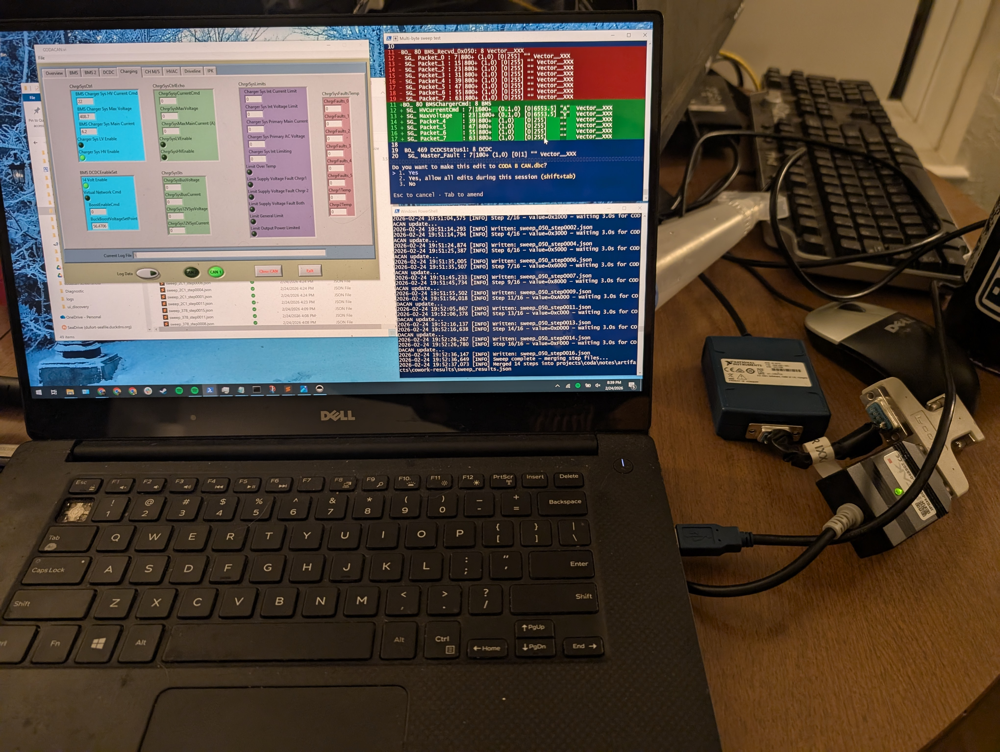
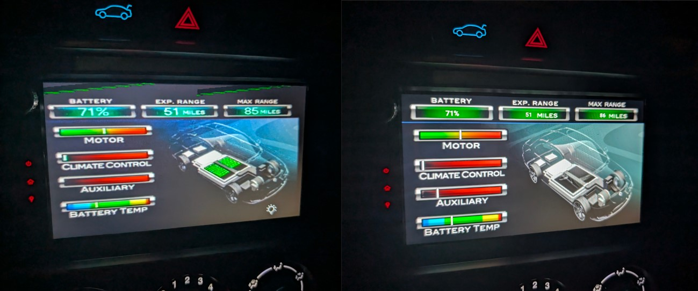

# Using LLMs to reverse engineer electric vehicle CANBuses

## Intro
I have a Coda and a Vtrux - both rare electrified vehicles from failed companies that are no longer around. The Coda itself has been actually quite reliable, other than a degrading battery, but the Vtrux has had all sorts of random issues. There are actually a few existing tools for the Coda - there are a few of the original dealer diagnostic tools for the Coda floating around (of which one I have), an individual cell voltage monitoring tool, and a Labview application that displays some CANbus messages. However, the Vtrux had basically nothing for the Via hybrid powertrain part of the truck. When Via was still in business, the way the company would support the vehicles would be to mail out a CAN logger, the user would take a CAN log, and then mail the scanner back, and then Via would tell the user the issue and could supply parts. But, now that Via is out of business, they no longer support the trucks. Very little CANBus definition for either vehicle was available, and what was available was limited: basically just the DCDC used on the Coda, the bidirectional charge unit used on the Vtrux, cell voltage definitions for the Coda, and the GM CANBus definition. With the Coda I could use the dealer diagnostic tool to diagnose issues, but with anything in the Vtrux electric powertrain system, all I had was circumstancial evidence, or blindly reading CAN logs - I can see when certain bits flip in certain orders, but without knowledge of what those bits mean, there's not much you can do with that information.

I had previously used LLM chatbot style interfaces for a few initial investigations, both for a basic investigation of a Vtrux log, in which I got some initial guesses of some of the Vtrux CANbus information, but given the context size you can't process a very large log. Similarly, when trying to reverse engineer the Coda scan tool's communication, copy pasting scripts and CAN logs between the web interface and my computer proved very cumbersome, and learnings would get lost when context was compacted, but was eventually generally successful. (This tool is on my Github as an independent repo, and has already been used by a couple other fellow Coda owners to diagnose their cars, and it is also included as a submodule in the Coda project folder)

Early 2026 I started using Claude Code for a project at work and immediately had the realization - this would be very powerful for reverse engineering CANbus logs. Doing manual analysis on CAN logs is doable, but it's very tedious. But now that the LLM can access the files in pieces directly, it could write scripts to process the logs, so it would not have to read the entire log into context - just write the script, run it, then read back the results. So I had it write me a basic Python framework for analyzing CAN logs, and then started asking it questions about the logs I had and it was able to pick things out very quickly that would have taken me a very long time to do manually. Very soon I was running multiple analyses at once, rapidly bouncing back and forth between different terminal windows, answering questions or approving tool uses and then moving to another window while it chugged through whatever it was doing. It very quickly became addictive - since I was learning so much so quickly about these projects all at once.

## A few words About AI and LLMs
One of the reasons I went so deep on this project was to get a deep understanding of these LLM tools and what they're good for and what they're not good for. At this point, I'm not really 'for' or 'against' AI or LLMs in general. I do think it's not particularly productive to be 'against' it - at least from a practical/techincal standpoint. Even outside of the scope of this project these similar tools have helped deal with a lot of tedious computer tasks, but at the same time, I don't use them for much else than that. I can understand the temptation to use them for sidestepping real human connection or for creative uses, but I myself think that's a bad road to go down. Yes, you can use it to generate a song or a recipe - but in my mind the true value behind such things is not the exact sound waves or combination of ingredients, but the story behind them. With a project like this though, I'm just using computers to get a leg up against different computers - I don't feel like using LLMs to speed up the process makes it any less soulful, because the process doesn't really have much soul in the first place.

One thing I wasn't ready for was how these tools worked with the way I've structured how I work on projects. I'm very used to accepting external limitations in my projects to give me good stopping points. But with these tools, I struggled with reaching stopping points for a few reasons:
- There's so much to be learned just from a few logs, and once I reach the conclusion from one session, it often enables multiple other sessions. And then since there's nothing blocking me from starting those sessions, I want to start them so I can learn from them and then start more sessions from those conclusions.
- With parallel work going on, it's very hard to get to the point where everything is done all at once. You either end up staring at the one remaining terminal just waiting for it to finish, or if you finish one project while another's still going, you start another, and then when the other session finishes up, the other's in the middle now, so you start yet another one or two, from the conclusions you made from another session. There were certainly some late nights because of this.
- Since the tedious part of the work is automated away, it's a lot less draining to work on, and since you learn things much faster, it's much more tempting to keep going since there's less time until the next big discovery. (Or at least, I think there is.)

## Abilities within the scope of this project
The best way to describe these LLM tools I've found is that now the computer knows how to use a computer. Once you have the basic toolset ready, you can give it a CAN log and a description of what happened and it can take over the investigation from there, and it works well for simple, specific things. I gave it a CAN log of me pressing the interlock switch on the Vtrux's small fuse access panel 5 times, told the tool that story, and let it analyze the log, and it very quickly correctly identified the bit on the CANbus that represented the interlock status. I gave it a log of me poking all the driver interface buttons and knobs in the Coda with a log of the timestamps, and it was very quickly able to identify all the bits of each function which had CANbus representation, and then the others that did not.

One thing I did a lot with it was have it run correlations - for example, I know the high voltage DC measurement of the charger module from an existing DBC, now go correlate that to the rest of the bus and see if you can find other messages that indicate other module's HV measurements. I was able to pick out the message containing the HV DC measurement from the DCDC during a charging log, and then using that DCDC measurement, correlate during more dynamic driving logs to get some of the battery, inverter, and individual high/low cell measurements this way, all very quickly, and with the ability to do other things in other sessions while the Python script it wrote digging through the data churns. But, it's easy for it to miss things that are not encoded in ways it knows to look for - for example, I had a whole session trying to find the Vtrux battery's charge and discharge limit broadcast messages, using a log where I hit both limits with known timestamps. It wasn't able to find them. Turns out, these were encoded as 2 12 bit values stuffed into 3 CAN bytes - and since it was only looking for 8 bit and 16 bit encodings, they didn't even turn up as high probability candidates. I was able to find a good amount of things running correlations like this, but this only helps for so much.

It was _all right_ at finding signals based on rough descriptions. But, the workflow still very much required me to be a part of it. For example, I gave it a log of me driving around with the Vtrux drivetrain coolant pump unplugged until overheat, and the timestamp the motor went into derating, and told it to find the message that contains the drivetrain motor temperature. It came back with a few candidates, but I really had to have it graph the signals for me, and then I had to manually read the graphs to make conclusions from them, and go back and forth a few times. It would try to read the graphs it generated and make conclusions, but these were nearly universally useless - in the end I gave it an instruction to just never try to read back the graphs and just only have me interpret the graphs. But, the message I identified from this ended up indeed being correctly an indication of drivetrain temperature - with an interesting caveat, noted below.

It was not particularly good at the assumptions it would make. It has a basic understanding of how electric vehicles work and how they're generally architected - I didn't have to teach it about contactors or interlock loops or DCDCs or whatever. But, that also means it can make somewhat informed suggestions, that are occasionally helpful in the moment - but often they're wrong, and if I don't catch them, and I let them get written into the documentation, then later it inevitably makes an even more wrong conclusion based on that other initially wrong assumption I didn't catch, and then I have to trace back to the initial wrong assumption and undo it, and then re-run both investigations to make proper conclusions. (This is where using multiple terminal sessions at once was helpful) As such, I had to become very careful about every single conclusion it would try to make from the data, and not just blindly approve documentation writes because I wanted to be done.

I also had to be careful about the language I let it use. One part of the Vtrux project was doing a few different logs of me unplugging various connectors and seeing what would happen. I let it document the results of this with the language 'dropout tiers', which propagated deeply into all sorts of documentation. When I was reviewing the documentation before publishing, it was just casually throwing in language like "dropout Tier C" - which is not particularly descriptive, and it was a somewhat extensive process to clean that all up and rephrase it to something more informative.

Pretty much the entirety of this project was done with Claude Sonnet 4.6. At one point it was struggling with the Android logger app I had it write me, and I tried switching to Opus to see if it would do any better. It really didn't. The answer to the problem I was having turned out to basically be just to give up, which these tools are not great at doing - you really just have to kind of watch for when they're going in circles, and then call it there, since they're probably not going to give up on their own.

## Processing logs was not the main source of useful data
The initial scope of this project was getting CAN definitions by processing existing logs. But, this has its limitations. If you're trying to determine if a signal is carrying current or power, they correlate very similarly. And you might know that the power limit of the truck is roughly 180kW for example, but it's very hard to tell if your truck is actually hitting 180kW, or if it's actually 160kW. And, how do you know the scale of your battery temperature measurement, if the only reference you have is the approximate ambient temperature of that day?

Turns out, for both projects, there were already existing tools that had much of the CANbus definition embedded in them, but it would have been a long and drawn out process to manually extract all the data. But the LLM tools allowed me to automate much of this away.

### Vtrux: The EPRI Logger App
The Vtrux was build as a sort of exploratory R&D project, and as such many trucks had data logging systems installed in them that would log data from the truck and upload it for studies. When I bought my first truck, I found an iPhone and a couple of Bluetooth OBD dongles hooked into a harness in the area above the pedals and below the steering wheel. It had an 'EPRI Logger' app on it that wouldn't open. This was when I first bought the truck in 2024, and didn't think much of it, until I was already fairly deep into the CANbus log analysis part of this project, but I was kind of running out of things to analyze based on the logs I had and I still didn't have a great understanding of the CANbus of the truck.

But, one day, I had the realization - what if that datalogging app could be decompiled and CAN bus definitions extracted from its source code? Sure enough, I was able to jailbreak the old iPhone (trivial since it was an iPhone 4s), pull the app off the phone, and then I pointed Claude Code to a copy of Ghidra that I downloaded, and very quickly it was able to use Ghidra (which it already had knowledge of how to use) to decompile the app, and come up with a pretty complete CANBus definition, correcting a few wrong assumptions I had made about the truck over the course of just a few evenings. Notably, I initially thought all the Via HV powertrain stuff was on a single CANbus, but this data confirmed that the drivetrain inverter was on a completely different CANbus - one of the two split CANbusses that up until that point I thought only contained split up data from the original GM portion of the truck). The drivetrain temperature message mentioned above turned out to be a rebroadcast, perfectly correlated to the message from the inverter directly. 

This helped me confirm a lot of my 'experimentally' determined information - for example, it confirmed the interlock status bit I had found out as mentioned above. Most importantly, this provided exact scaling data - I had previously correctly identified the messages containing min and max cell temperatures (helped by the fact they were contained in the same message as the min/max cell voltages) - but I had the scaling wrong. Similarly, I had only vague guesses of current and power scaling, but this helped me confirm which messages were DC current vs power and the exact scaling of both - originally I only had vague guesses based on what the dials on the dash of the Vtrux showed. It also provided enum string definition (for example, what bit sequence maps to what contactor states).

### Coda: The CODACAN Labview Application
This came at an earlier point in the project than the EPRI app decompile, but still proved to be the main source of data for the Coda DBC definitions. I had previously tried to decompile the Labview application with a python labview decompiler tool and was able to get a few message IDs and signal names, but no bit fields or scaling information except for the Coda DCDC, which I already had since it was directly defined in the manual. But, I was able to have Claude Code write me scripts to automate replaying logs into the Coda application and taking screenshots and reading the text via OCR to understanding which fields were which and the scaling for them. It took a while to get the image processing framework to work, but once it did, I was able to have it run replays while I was at work or overnight and then come back afterwards to a processed data set and suggested new CANBUS definitions, scaling, and enum definitions.

## Android Apps
One secondary part of this project was that I was able to have it write me an Android app, complete with apparently from scratch writing an Android USB driver for the cheap Innomaker CAN dongles, such that I could have my Android tablet based headunit I installed in the Coda act both as a CAN logger, and as a replacement for the original 'green screen' in the Coda. It turned out that the box that generated the green screen (which previously was fed into the backup camera input) just stored the base images on an SD card, so it was trivial to import those images and then using the CANbus definitions extracted from the investigation, replicate this display. And now it works in the cold - which the original green screen often did not. (It's missing a few minor things, such as the green graphics in the battery that indicate state of charge)

## Conclusions
I'm releasing this information both to help others use this tool for reverse engineering CANbus logs for other vehicles, and also as a specific knowledge base for either of these vehicles. Hopefully someone finds it useful. If you have either of these vehicles and you are interested in keeping it running, or just want to discuss using these tools for CANBus reverse engineering, please reach out to me, I'd love to help.

## Additional notes
Some of the Vtrux analysis relies on a GMLAN definition pdf and derived dbc which is nominally proprietary information. I was able to find the base PDF without much of a struggle, but I will not provide it or its derived DBC here in this repo. However, if you can find the file yourself, I have included the script that was used to extract the data from that PDF and turn it into a dbc. However, much of this definition was also in the EPRI decompile, which I have included, since that came from a different source.