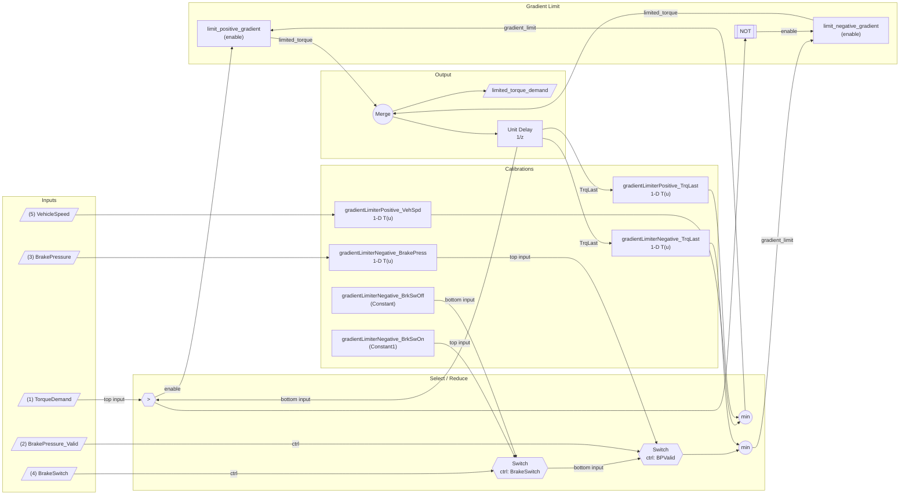

# DLCM Torque Flow — Mermaid re-transcription

Re-transcription of `dlcm-torque-flow-chart.png` for review. Source of truth is the PNG; this file exists so the topology can be checked in text form.

Switch-block convention (Simulink default): when the control input is non-zero / true, the **top** data input is passed; otherwise the **bottom** data input is passed.



## Calibration items implied by the chart

Four 1-D lookup tables and two scalar constants:

| Name | Type | Indexed by |
|---|---|---|
| `gradientLimiterPositive_VehSpd` | 1-D LUT | VehicleSpeed |
| `gradientLimiterPositive_TrqLast` | 1-D LUT | TrqLast (z&#8315;&#185;) |
| `gradientLimiterNegative_BrakePress` | 1-D LUT | BrakePressure |
| `gradientLimiterNegative_TrqLast` | 1-D LUT | TrqLast (z&#8315;&#185;) |
| `gradientLimiterNegative_BrkSwOn` | scalar constant | — |
| `gradientLimiterNegative_BrkSwOff` | scalar constant | — |

## Effective rate-limit equations

Positive path (active when `TorqueDemand > limited_torque_demand_prev`):

```
rate_limit_pos = min( gradientLimiterPositive_VehSpd[VehicleSpeed],
                      gradientLimiterPositive_TrqLast[TrqLast] )
```

Negative path (active otherwise):

```
brk_sw_K        = BrakeSwitch ? gradientLimiterNegative_BrkSwOn
                              : gradientLimiterNegative_BrkSwOff
selector_out    = BrakePressure_Valid ? gradientLimiterNegative_BrakePress[BrakePressure]
                                      : brk_sw_K
rate_limit_neg  = min( selector_out,
                       gradientLimiterNegative_TrqLast[TrqLast] )
```
