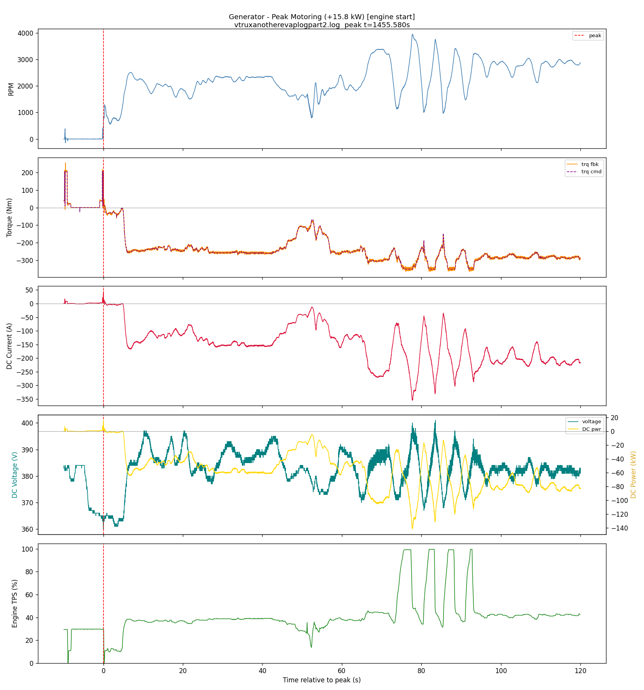
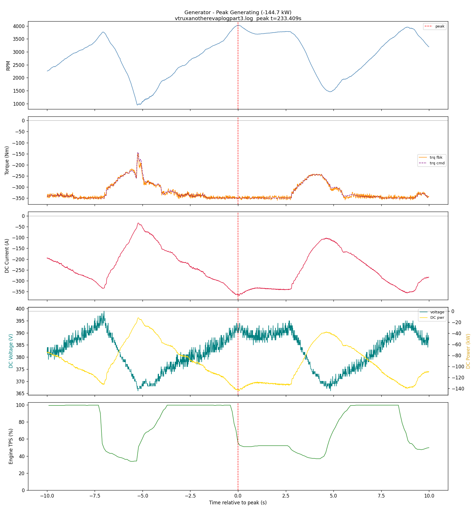
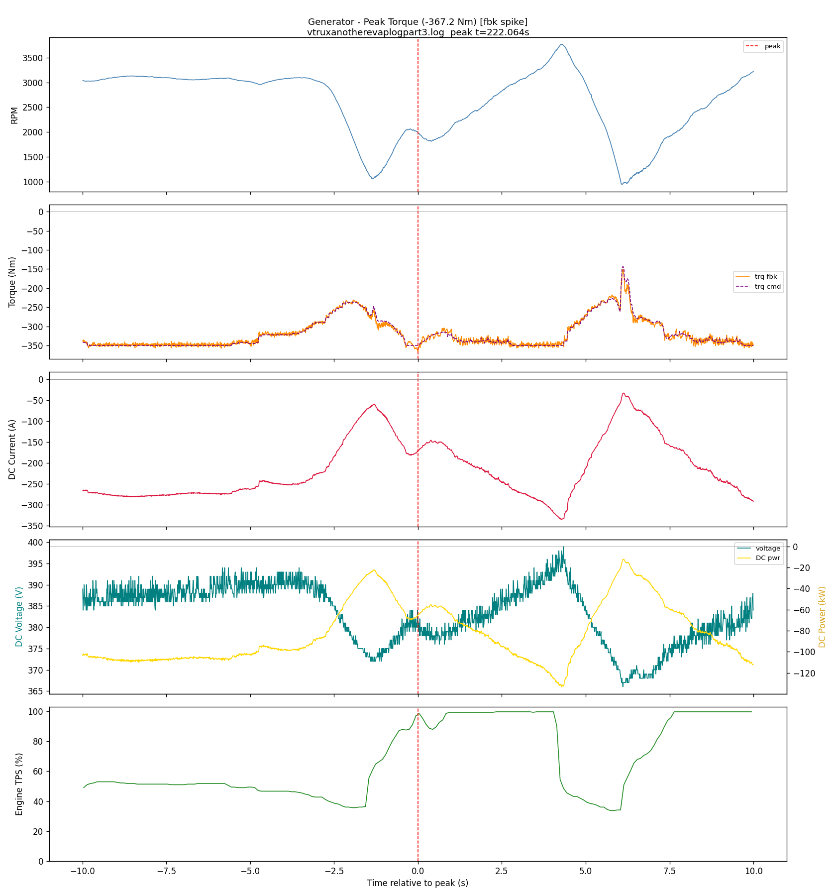
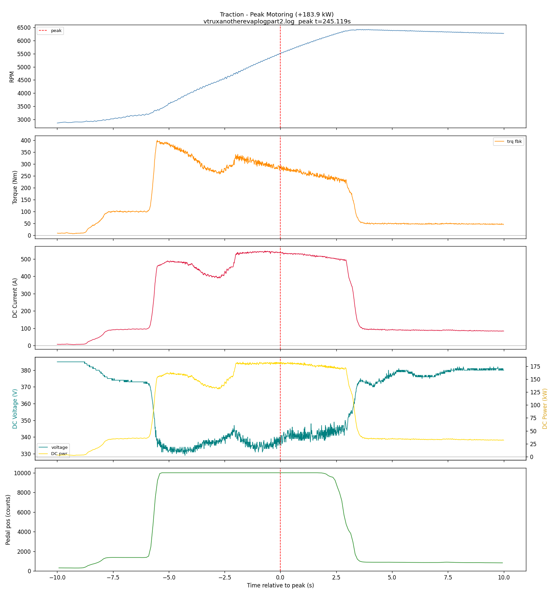
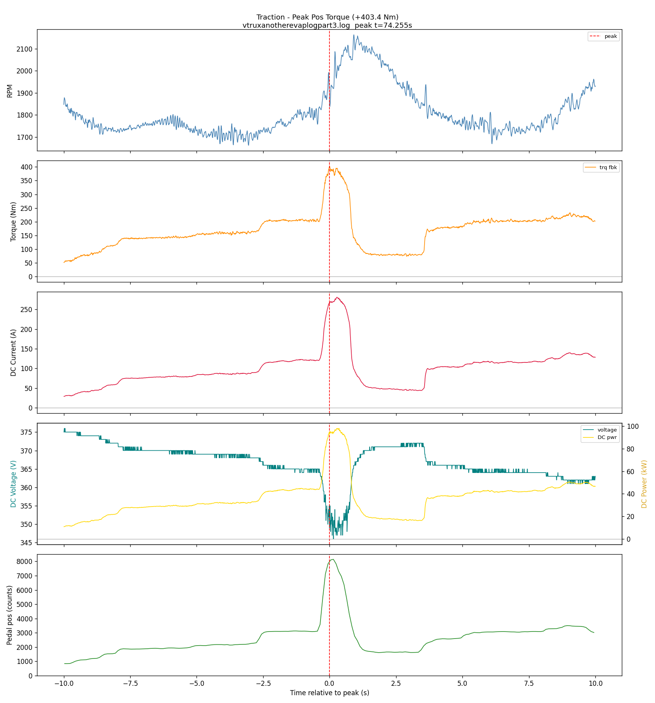
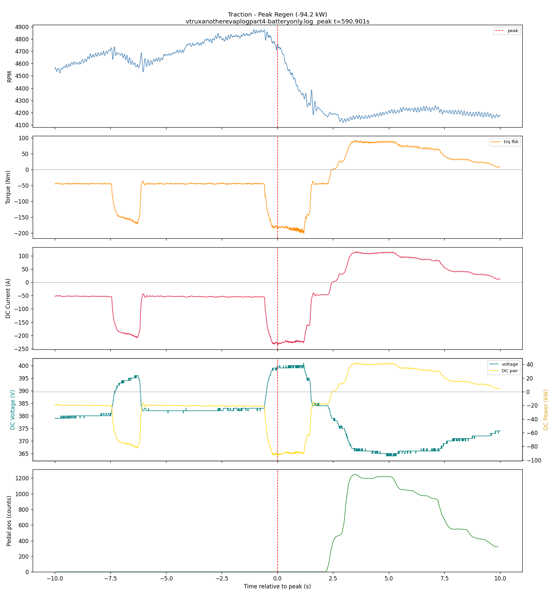
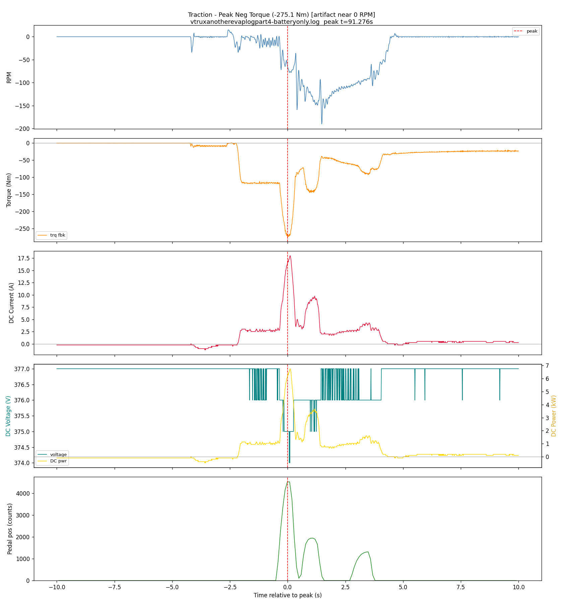
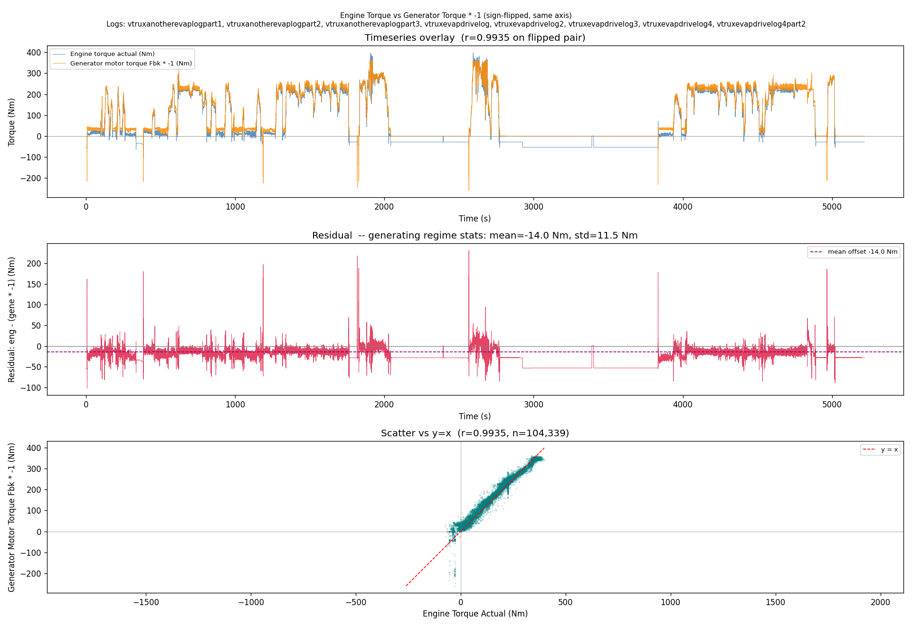

# Peak Operating Points

Observed peak power and torque values from the evap drive logs (`vtruxanotherevaplog*`, `vtruxevapdrivelog*`). All DC power values from inverter HV telemetry (V*I): generator from 0x482, traction from 0x462. Source plots in `artifacts/`.

## Generator

| Event | Value | Context |
|-------|-------|---------|
| Peak generating power | **-144.7 kW** | -367A, 394V, 4023 RPM, -352.5 Nm. Occurs immediately after TPS drops from ~100% to ~50% — engine just released from full-throttle climb, generator still drawing heavily as RPM overshoots before load settles. |
| Peak generating torque | -367.2 Nm | At 1992 RPM, -65.1 kW DC. Confirmed feedback spike — torque command is smooth throughout, feedback briefly overshoots. TPS is at nearly 100% at this moment (full engine load). Discard as a true torque limit measurement. |
| Peak starting | +15.8 kW | Engine start event. Generator driven as starter motor during start sequence.|

### Generator — Peak Starting (engine start, +15.8 kW)

### Generator — Peak Generating (-144.7 kW)

### Generator — Peak Torque feedback spike (-367.2 Nm)

## Traction

| Event | Value | Context |
|-------|-------|---------|
| Peak motoring power | **+183.9 kW** | 541A, 340V, 5500 RPM, +285.5 Nm. DC current limit visibly constrains torque during the event — torque drops as battery DCL bites, then recovers as the generator spools up and offloads the battery. |
| Peak positive torque | +403.4 Nm | At ~1888 RPM, 92.6 kW DC. Full-throttle launch from low speed, before the motor enters flux-weakening range. |
| Peak regen power | **-94.2 kW** | -235.5A, 400V, 4754 RPM, -185.1 Nm. Stable RPM (+56 RPM/s), genuine regen event. |
| Peak negative torque | -275.1 Nm | At -66 RPM — vehicle in reverse, not regen braking. Negligible DC power (6.2 kW). Discard as a peak regen operating point. |

### Traction — Peak Motoring (+183.9 kW)

### Traction — Peak Positive Torque (+403.4 Nm)

### Traction — Peak Regen (-94.2 kW)

### Traction — Peak Negative Torque (reverse, artifact)

---

## Engine Torque Estimate vs Generator Torque Correlation

**Signals:** `Engine_Torque_Actual_Extended_Range` (0x1C3, OBD bus, ECM native) ↔ `GENE_Mot_Trq` (0x471, PT bus)

**Logs:** All evap drive logs (`vtruxanotherevaplog*`, `vtruxevapdrivelog*`)

**Script:** `artifacts/engine_gen_torque_correlation.py` (aligned cache: `artifacts/engine_gen_torque_aligned.csv`)

### Sign-flipped overlay

Generator torque is sign-flipped (* -1) so both traces share the same axis and zero point. Traces nearly overlap during active generation.

### Regime-separated correlation results

| Regime | Threshold | n samples | Pearson r | Eng mean | Gen * -1 mean | Notes |
|--------|-----------|-----------|-----------|----------|---------------|-------|
| Generating | gene < -30 Nm | 58,663 | **-0.9946** | +160 Nm | +174 Nm | Near-perfect anti-correlation |
| Idling | -30 to +20 Nm | 45,457 | -0.794 | -33 Nm | +3.2 Nm | Mixed: light-load real data + engine-off VCM spoof at -53 Nm dilutes r |
| Starting | gene > +20 Nm | 219 | +0.07 | -36 Nm | -76 Nm | Engine-start crank only (~11 s total); ECM reports drag torque, no correlation |

**Generating regime detail:** Mean engine torque +160 Nm vs mean generator absorption +174 Nm. Sign-flipped residual (generating windows only, n=58,663): mean −14.04 Nm, std 11.50 Nm. The engine torque estimate consistently reads ~14 Nm below the generator torque feedback; cause unknown, likely a systematic bias in the ECM torque estimate.

**Engine-off behavior:** In logs where the engine never started, 0x1C3 OBD bus reads a constant -53 Nm (VCM spoof value) while generator torque reads ~0. These periods populate the idling regime and dilute its correlation.

**Windowed r by dominant regime (30 s windows, >=70% pure):**
- Generating: 180 windows, r min = -0.997, max = +0.200, mean = -0.857 (transitional windows at boundaries pull mean up slightly)
- Idling: 104 windows, r min = -0.978, max = +0.613, mean = -0.078 (wide spread: engine-off vs genuine light-load mixed)
